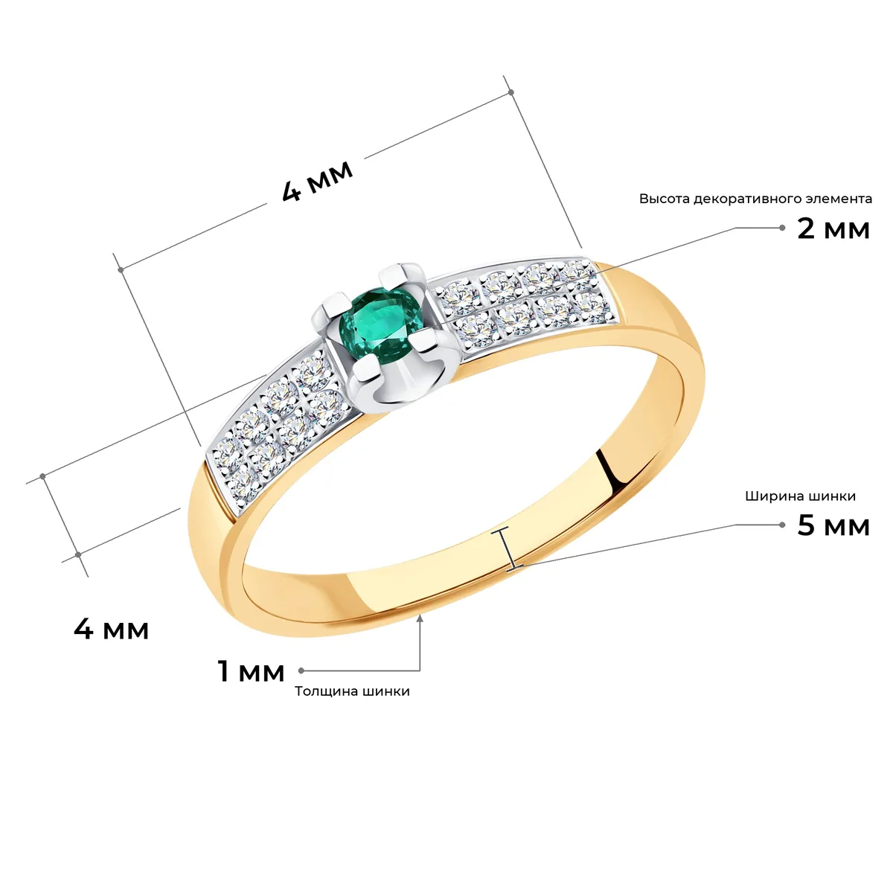
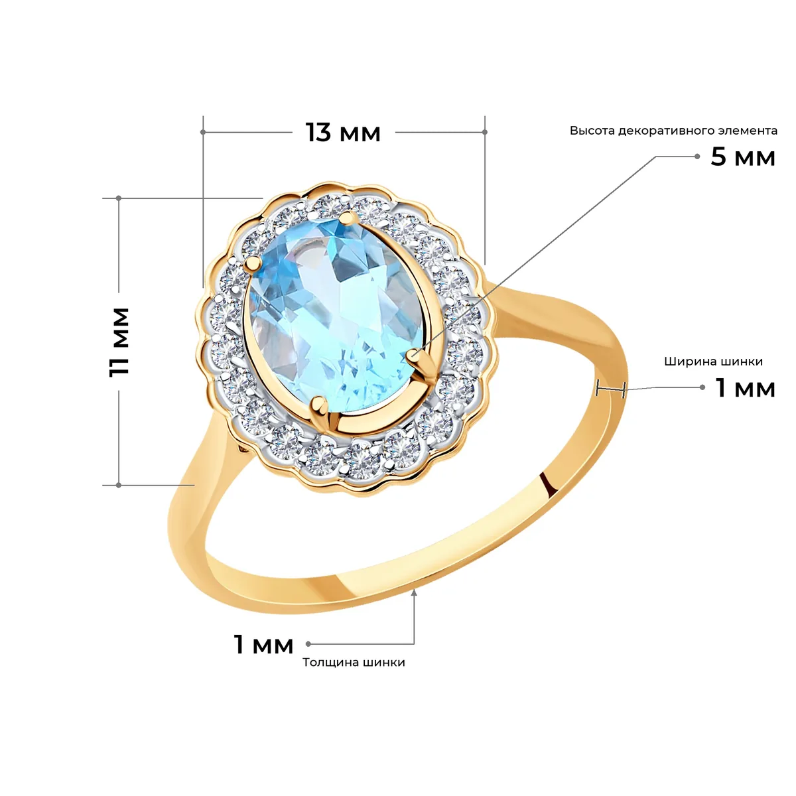
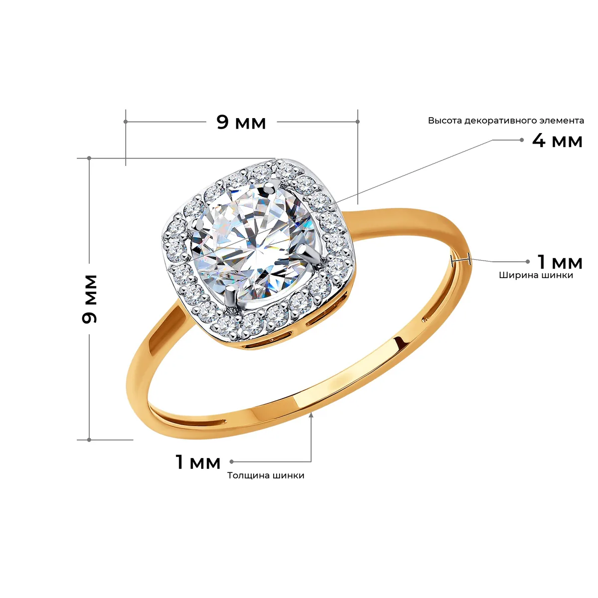

# Размеры на фото украшений

Это моя производственная практика. Задача звучала просто: на 939 студийных фото колец и
других украшений нанести пять размеров из рабочей таблицы (длина, ширина и высота декоративного
элемента, толщина и ширина шинки) в стиле эталонных карточек каталога SOKOLOV. Тонкие
серые линии, подписи «N мм», выноски для того, что на ракурсе не видно.

Руками это недели работы в фотошопе. Генерировать картинку нейросетью нельзя: она
искажает изделие и путает числа, а в карточке товара оба промаха недопустимы. Поэтому я
сделал так: **модель зрения только смотрит на фото и говорит, где декоративный элемент,
где шинка и какой это ракурс, а все линии и числа рисует код поверх исходных пикселей.**
Числа всегда совпадают с таблицей, изделие остаётся нетронутым.

| | | |
|---|---|---|
|  |  |  |

Фото изделий и рабочие таблицы принадлежат заказчику и в репозиторий не входят. Здесь
только код и пара готовых кадров для примера.

## Что умеет

- **Пакетная разметка** всей выборки одной командой: читает таблицу, размечает каждый
  кадр и пишет отчёт со статусами.
- **Пять габаритов в одном стиле**: размерные линии, выносные линии, полки с подписями,
  вертикальный текст повёрнут на 90°, всё по эталонным карточкам.
- **Концы линий садятся точно на изделие**: по маске силуэта ищется первый металл маршем
  луча, а не отступом от рамки, поэтому на скруглённой шинке ничего не висит в воздухе.
- **Невидимые размеры не дорисовываются**: если на ракурсе нет шинки, кадр получает
  статус «Нужен другой ракурс», а не выдуманную линию.
- **Веб-редактор разметки**: любой габарит можно поправить мышью, правка переносится на
  похожие кадры, а в чате ассистент (Claude) правит раскладку сам.
- **Контактный лист** для быстрой проверки всей выборки глазами.
- Работает и **без модели**, только на геометрии, если ключа API нет.

## Стек

- **Python 3.11+**
- **OpenCV + NumPy**: маска изделия, контуры, промеры, марш лучей
- **Pillow**: отрисовка линий и текста шрифтом Montserrat
- **openpyxl**: чтение рабочей таблицы с размерами
- **Модель зрения** через совместимый с OpenAI и Anthropic API (ключ в переменной
  `PROXYAPI_KEY`): только детекция и ракурс, никакой генерации
- **Веб-редактор** без фреймворков: обычные HTML, CSS и JS, сервер на стандартной
  библиотеке Python

## Главное о подходе

Изображение **не генерируется заново**. Модель зрения используется только как
измеритель: она отвечает, где на кадре декоративный элемент, где шинка и какой
это ракурс. Линии и числа наносятся кодом поверх исходного пикселя.

Все концы разметки сажаются на силуэт изделия расчётом по маске, а не отступом от
рамки: конец выноски ищется маршем луча от полки до первого металла
(`Product.ray_hit`), выносная линия габарита — таким же лучом со стороны размерной
линии, под каждым её концом отдельно. Одна кромка на оба конца годится только ровному
краю: на скруглении — а шинка скруглена вся — один конец повисает в воздухе, второй
уезжает внутрь металла.

Сам габарит при этом доводится до настоящего конца элемента. Рамка декоративного
элемента ставится по его плотной части, и сходящий на нет хвост в неё не попадает: у
кольца с дорожкой паве вдоль шинки дорожка сужается и мельчает, рамка обрывается на
полпути, а габарит показывает меньше, чем есть. Поэтому от кромки рамки идёт марш
наружу (`_tail` в `markup/layout.py`), и хвостом считается только то, что ведёт себя как
хвост: на кромке он уже тонкий (не толще трети поперечника рамки), дальше не толстеет и
кончается на контуре изделия. Плечо шинки отсеивается на первом же условии — оно
подходит к рамке во всю толщину. Правило умеет только удлинить габарит до конца
элемента и никогда — увести его на соседнюю деталь: любой отказ оставляет габарит на
кромке рамки. На контрольной выборке из 40 кадров габарит сдвинулся на 5, не больше чем
на 11 % длины.

Сама выносная линия при этом до изделия не доводится: у неё своя короткая длина
(`ext_max`), и в эталонных выкладках у габарита стоит именно засечка. Дотянутая до
силуэта, линия прочерчивает половину кадра, перетягивает взгляд на себя и на светлом
металле сама теряется. Кромку луч ищет по-прежнему — она нужна с другой стороны: если
металл ближе засечки, линия останавливается на нём и на изделие не заезжает.

Отсюда три следствия, прямо закрывающие критерии приёмки:

- **числа всегда совпадают с таблицей** — они берутся из строки задания, а не
  придумываются моделью;
- **изделие не искажается** — исходник только кадрируется по белому фону и
  равномерно масштабируется, ни один пиксель самого изделия не перерисовывается;
- **невидимые ракурсы не дорисовываются** — размер, которого на кадре не видно,
  показывается выноской с подписью, как в эталонах.

## Масштаб кадра и проверка габаритов

Габарит — это утверждение о кадре: «вот отсюда досюда, и это столько-то
миллиметров». Утверждение проверяемое, и до сих пор оно не проверялось: масштаб
выводился из рамки декоративного элемента, а рамка сама себе не свидетель. На
контрольной выборке из 178 кадров **у 81 два габарита противоречили друг другу** —
один и тот же кадр говорил, что в миллиметре то 20 пикселей, то 250. Отсюда и
линия во всю высоту кольца, подписанная «3 мм».

Поэтому мер масштаба теперь две, и вторая от рамки не зависит ().
Кольцо всегда размером с палец: наружный диаметр — это большая сторона кадра, а
она при вписывании в холст известна. Когда в таблице стоит размер кольца — «длина»
в 30 мм и больше, это обхват, — внутренний диаметр берётся из него. Мера грубая
(децили 0,70 и 1,35), но несмещённая: медиана отношения «рамка / кольцо» на
согласованных кадрах — 0,96. Она не уточняет масштаб, а ловит промах в разы.

Из этого следуют три правила.

**Рамка выбирается, а не назначается.** Кандидатов трое: закреплённая человеком,
найденная по контрасту, присланная моделью. Выбор идёт по расхождению с масштабом
кадра. Раньше закреплённая бралась не глядя — но закрепляются не только правки,
сделанные глазами: та же правка переносится на полсотни похожих кадров
(), и на кадре, который лишь похож, она садится центром выше
изделия. Человек по-прежнему главный, но его рамка уступает, если другая сходится
с кадром заметно лучше, и об этом пишется замечание.

**Размер, не сошедшийся со своим числом, перестаёт быть габаритом** и уходит на
выноску с подписью — тем же способом, каким показана высота декоративного
элемента, и по той же причине: этого размера на кадре нет. Так уходит размер
кольца (54 мм — длина дуги, а не отрезка) и ширина шинки, записанная в графу
декоративного элемента.

**Размер-двойник шинки показывается интервалом.** Когда в графе «ширина
декоративного элемента» стоит та же цифра, что и в графе шинки, это не совпадение:
декор там и есть шинка. Такой размер рисуется вторым интервалом с засечками на
противоположной дуге кольца, а не стрелкой в центр изделия.

## Ширина шинки: промер по малой оси

Прежний промер шёл по контуру просвета: луч наружу до первого металла и сечение
поперёк хода шинки. У ровно снятого кольца это работало, у наклонённого — нет.
Просвет наклонённого кольца смещён к ближнему краю, и луч из его контура попадает
не на лицевую грань, а на внутреннюю поверхность дальней стенки.

Теперь промер привязан к малой оси силуэта — направлению, в котором на кадр
проецируется ось кольца. На её концах шинка повёрнута к камере плоскостью и
показывает ширину целиком; на концах большой оси она уходит в торец. Лучей
пускается веер: один луч на ажурном кольце проваливается в просечку.

Три поправки, без которых промер не сходился:

- **Маска.** Тонкая маска дырявится на бликах — полированная шинка под прямым
  светом уходит в чистый белый, и луч обрывался в пяти пикселях от кромки: на
  широком ободке так терялось девятнадцать проб из двадцати одной. Промер идёт по
  залитому силуэту с вырезанным просветом.
- **Ожидание.** Сечение на конце малой оси — это толщина, сокращённая на косинус
  наклона, плюс ширина, сокращённая на синус. Конец, попавший на декор вместо
  шинки, выдаёт себя сразу: у кольца с ореолом он даёт впятеро больше ожидаемого.
- **Длина интервала.** Интервал идёт от наружной кромки внутрь на долю грани, а не
  на всё сечение: сечение шире грани ровно на толщину, сокращённую ракурсом. На
  широкой шинке грань занимает девять десятых сечения, на тонком ободке — половину;
  прежняя постоянная доля 0,77 была средним и на обоих концах врала.

Кольцо, снятое в фас, ширины шинки не показывает вовсе: она идёт прямо в камеру.
Узнаётся это по таблице — промер совпал с табличной толщиной, а ширина заметно
больше, — и размер уходит на выноску со стрелкой.

## Установка

```bash
pip install -r requirements.txt
```

Ключ ProxyAPI кладётся в `.env` рядом со скриптом:

```
PROXYAPI_KEY=sk-...
PROXYAPI_MODEL=gpt-5.1
```

Шрифты Montserrat лежат в `assets/fonts/`. Если их нет, скрипт подставит
Segoe UI Semibold или Arial Bold.

## Запуск

Пилотная партия с записью статусов в рабочую таблицу:

```bash
python annotate.py --task "данные/Рабочая_таблица.xlsx" --batch "Пилот" --write-xlsx "данные/Рабочая_таблица.xlsx"
```

Отдельные позиции, с перерисовкой и сохранением плана разметки:

```bash
python annotate.py --task "данные/Рабочая_таблица.xlsx" --ids S2-001 S2-016 --overwrite --debug
```

Партия из markdown-задачи:

```bash
python annotate.py --task "данные/Задачи/Партия_01.md" --workers 6
```

Контактный лист для визуальной приёмки:

```bash
python contact_sheet.py --dir out --cols 5 --out "out/_контроль/пилот.png"
```

## Редактор разметки

Локальный веб-редактор, в котором цикл замкнут целиком: своё фото и пять чисел —
разметка с анимацией нанесения — правка любого габарита мышью — обучение автомата
на этих правках — галерея готовых кадров. Запускается из PowerShell одной командой:

```powershell
.\Редактор.ps1
```

PowerShell ищет `.\` в текущей папке, поэтому запускать надо из каталога проекта.
Из любого другого места — по полному пути:

```powershell
powershell -ExecutionPolicy Bypass -File "C:\путь\к\проекту\Редактор.ps1"
```

Проще всего — открыть двойным щелчком `Редактор.cmd` в папке проекта: он сам
переходит куда надо и передаёт все ключи дальше.

Скрипт сам находит Python, доставляет недостающие библиотеки и открывает
`http://127.0.0.1:8765/`. Ключи: `-Port 9000`, `-NoOpen`, `-Task <путь к xlsx>`,
`-Code нет|сайт|всё` — что Опусу разрешено править. Без PowerShell —
`python viewer.py`.

Проект под git: правки Опуса ложатся отдельными коммитами, любую можно снять.

Что там есть:

- **загрузка своего фото**: снимок плюс пять размеров — и кадр размечается тут же,
  с анимацией нанесения;
- **галерея** с фильтрами по партии, статусу, наличию правок и своим загрузкам,
  поиском по ID и номенклатуре;
- **разбор кадра**: рамка декоративного элемента, точка промера шинки и все линии
  разметки поверх исходного снимка, рядом — масштаб мм/пиксель по обеим осям,
  расхождение между ними, промер шинки против таблицы и замечания раскладки;
- **правка любого габарита мышью**: концы размерных линий, вынос самой линии,
  полки и стрелки выносок, интервалы шинки, сторона полки, рамка декоративного
  элемента и место промера. Кадр перерисовывается на месте, сеть при этом не
  трогается — план уже лежит в `cache/plans/`;
- **обучение на правках**: то, что человек делает одинаково от кадра к кадру,
  автомат перенимает сам; что не обобщается — предлагает перенести и ждёт
  подтверждения;
- **статусы**: запоминаются в `out/_контроль/правки.json`, кнопка «В таблицу»
  переносит их в `Рабочая_таблица.xlsx` (рядом кладётся резервная копия).

Правка помечает план флагом `manual`, и дальше её не перебивает ни повторный
прогон, ни `--replan`: ответ человека дороже ответа модели.

### Своё фото: цикл замыкается

Рабочая таблица описывает девятьсот чужих кадров, но у редактора есть и обратный
ход. Кнопка «Загрузить фото» в шапке принимает собственный снимок и те же пять
чисел — длину, ширину и высоту декоративного элемента, толщину и ширину шинки, —
и дальше идёт ровно тот же путь: отделение изделия от белого фона, вопрос модели
о геометрии, раскладка, отрисовка. Готовый кадр попадает в общую галерею с
пометкой «своё фото», правится теми же ручками и убирается одной кнопкой вместе
со снимком, планом и миниатюрой.

Менять ради этого пайплайн не пришлось: он работает не с таблицей, а со строкой
каталога — id, пять размеров и ссылка на снимок. Загрузка и делает такую строку,
только ссылкой служит путь к файлу на диске (`markup/uploads.py`, список лежит в
`cache/загрузки/каталог.json` и переживает перезапуск).

**Числа берутся из формы и не обсуждаются** — то же правило, что и для таблицы.
Модель зрения и здесь работает измерителем: она отвечает, где декоративный
элемент и какой это ракурс, а миллиметры приходят от человека. Снимок не
перерисовывается, только приводится к JPEG и ужимается по стороне: «изделие не
искажается» относится и к своим фотографиям.

Нанесение показывается чертежом: линии проявляются по очереди, как будто их ведут
рукой, и только потом на место встаёт готовый PNG. Это не украшение — по очереди
видно, что откуда взялось: сначала габариты декоративного элемента, потом выноска
размера, которого на ракурсе нет, потом метки шинки. Чертёж строится тем же
расчётом, что и сам кадр, — сервер отдаёт редактору не только координаты линий, но
и мерки стиля (кегль подписи, вынос засечки, длина полки), поэтому схема и
результат совпадают, а не изображают друг друга.

### Правка любого габарита

Раньше мышью правились только рамка декоративного элемента и якорь выноски
высоты. Этого мало: чаще всего к кадру есть одна претензия — «эта линия не там», —
и чинить её через рамку значит двигать всё остальное заодно.

Теперь у каждой из пяти меток свои ручки:

| Ручка | Что двигает |
| --- | --- |
| кружок на конце габарита | конец размерной линии вдоль её оси |
| сама размерная линия | вынос габарита от изделия; перетащенная через изделие, она меняет сторону, и выносные разворачиваются за ней |
| ромб на изломе выноски | полку вместе с числом и подписью |
| квадрат на конце полки | разворачивает полку в другую сторону |
| кружок у стрелки | куда указывает выноска |
| кружки на засечках | интервал шинки — на какой участок ободка он лёг |

Справа список всех пяти размеров: наведение подсвечивает линию на кадре, кнопка
рядом возвращает **один** размер автомату, не трогая остальные правки.

Правка хранится по полям, а не целым элементом (`Plan.tweaks`): тронули конец
габарита — записан только конец, вынос линии по-прежнему считает раскладка. Иначе
одна правка замораживала бы кадр целиком, и любое улучшение кода до него уже не
дошло бы.

Накладываются правки в одном месте — при укладке элемента в лист (`Sheet.add`).
Причина в том, что размер по дороге меняет способ показа: не сошедшийся с кадром
габарит уходит на выноску, размер-двойник шинки — на интервал. Правка обязана
ехать за размером, а не за номером фигуры в списке.

Два следствия, без которых правка оборачивалась бы против себя:

- **габарит с правлеными концами остаётся габаритом.** Человек дотянул линию до
  настоящего конца элемента — длина разошлась с табличным числом сильнее прежнего,
  и проверка `_fits` отправила бы размер на выноску, туда, где этой правки уже не
  видно;
- **сторона размерной линии пересчитывается по её новому месту.** Выносные линии
  идут от размерной к элементу, и линия, перенесённая на другую сторону изделия,
  иначе стреляла бы ими в противоположную сторону.

### Привычки раскладки

Часть правок повторяется от кадра к кадру, и это не свойство кадра, а привычка
технолога: на каком расстоянии он держит размерную линию, куда ставит полку
выноски, в какую сторону её разворачивает. Такие правки записываются в
`cache/привычки.json` (`markup/habits.py`) в безразмерном виде — вынос в долях
первого эшелона от ближней кромки силуэта, полка в долях рамки изделия, — и как
только по паре «тип изделия + ракурс» набирается три отметки, автомат начинает
ставить линию туда же сам. Это то же самое, что уже работало на якоре выноски
высоты, только распространённое на всю разметку.

Записывается **только то, что человек действительно тронул**. Иначе правка конца
габарита заодно «подтверждала» бы вынос линии, которого никто не двигал, и через
три кадра автомат намертво приколотил бы её туда, куда он и сам её ставил, — а
заодно отнял бы у раскладки право разводить конфликтующие подписи эшелонами.

И **концы габарита привычкой не считаются вовсе**. Докуда тянется декоративный
элемент — свойство конкретного кадра: перенести это на соседнее кольцо значит
соврать про его размер. Такие правки идут другим путём — через разбор Опусом и
перенос на кадры, подтверждённые человеком.

Снятая правка стирает и отметку: держать её в журнале значило бы учить автомат
тому, от чего человек отказался.

Панель «Чему научился» показывает оба журнала — якоря и привычки — вместе с тем,
сколько отметок набрано и работает ли уже правило.

### Якорь выноски высоты

Высоты декоративного элемента на ракурсе не видно, поэтому стрелка выноски —
самое спорное место разметки. Автомат берёт ближайшую к полке точку **металла
внутри самого элемента** (`Product.nearest_in_rect`): так стрелка не втыкается в
пустоту и не съезжает на шинку, которая подходит к декору вплотную.

Куда именно её ставить, решает привычка технолога, а не геометрия. Поэтому в
редакторе якорь можно перетащить — красный крест на кадре. Каждая отметка
записывается в `cache/якоря.json` в собственных координатах элемента: доля вдоль
длинной оси и доля поперёк неё. Как только по паре «тип изделия + ракурс»
набирается три отметки, автомат берёт их медиану и ставит якорь туда же на
остальных кадрах. Медиана устойчива к одному промаху мышью; перенос привычки на
другой ракурс того же типа требует вдвое большего запаса отметок.

Панель «Чему научился» в шапке показывает, что уже набрано и работает ли оно.

### Разбор правки

Кнопка «Разобрать правку» показывает Опусу (`claude-opus-5` через тот же ключ
ProxyAPI) исходный кадр и то, чем правка человека отличается от сегодняшнего
автомата: рамку против рамки и перестановку разметки, описанную словами — «конец
габарита сдвинут на +12 % длины», «полка развёрнута влево». Сравнивается именно с
тем, что автомат дал бы сейчас, а не с тем, что было на момент правки: между ними
мог смениться и план, и код раскладки.

Ответ ложится в `cache/правила.json` с пометкой области — «рамка» или
«раскладка». Пометка нужна, потому что правила подмешиваются в промпты как
few-shot примеры, а промпт у них разный: подсказке про каст и шинку нечего делать
в разговоре про вынос размерной линии. Записи, сделанные до появления
разделения, считаются правилами про рамку — тогда других и не было.

### Перенос правки на похожие кадры

Промахи автомата однотипны: если на кольце в три четверти он обвёл только камень
без каста, то же самое он сделал и на полусотне соседних. Кнопка «Перенести на
похожие» работает в три шага, и человек стоит в конце:

1. **Отбор по признакам** — бесплатно: тот же тип изделия, тот же ракурс, близкие
   табличные пропорции, готовый план в кэше.
2. **Проверка Опусом** — он смотрит на кадр-образец и на кандидатов пачкой и
   отвечает, у кого та же беда. Числа похожесть не доказывают, а глаза доказывают.
3. **Предложение, а не правка** — подтверждённые кадры перерисовываются и
   помечаются как предложенные. В галерее они отбираются фильтром «предложенные
   правки», и там же их принимают или отклоняют пачкой.

Сама правка описывается не пикселями, а преобразованием в координатах элемента:
во сколько раз растянуть вдоль оси и поперёк, куда сдвинуть центр в долях сторон,
на сколько довернуть. Такое описание не зависит от масштаба кадра, поэтому одна и
та же правка одинаково ложится на крупное кольцо и на мелкое.

Тем же порядком переносится и перестановка разметки: вынос размерной линии, полка
выноски, её сторона, концы габарита в долях рамки элемента. Переносится строго
то, что человек тронул: концы, записанные «заодно», прибили бы габарит на
кандидате к кромкам его собственной рамки — а правка про неё ничего не говорила.
**Интервал шинки не переносится вовсе**: место промера выбирается по самому кадру,
по тому участку ободка, где лицевая грань видна целиком, и на другом кольце эта
точка попадёт мимо металла.

Молча переписать девятьсот кадров нельзя: одна неверная догадка испортила бы всю
выборку, а заметили бы это уже у заказчика.

### Чат: Опус правит сам

Чатов два, и они не смешиваются. **«Чат» в шапке** — про весь редактор: вопросы по
устройству и правки самого сайта. **Панель в карточке** — про этот конкретный кадр:
подвинуть рамку, переставить якорь, перенести правку на похожие. Переписка у каждой
позиции своя, поэтому разговор про одно кольцо не тянется в разбор другого.

В чат можно бросить картинку — перетаскиванием, скрепкой или вставкой из буфера;
она ужимается прямо в браузере и уходит Опусу вместе с вопросом. Рядом с заголовком
переключатель усилий: `быстро`, `обычно`, `вдумчиво`, `дотошно`, `предельно`. Это
`output_config.effort` в API: чем выше, тем дольше модель думает перед ответом.
Выбор запоминается в браузере.


В детали кадра есть панель «Опус правит сам». Опусу даны те же ручки, что и
человеку в редакторе, и он вызывает их сам:

| Инструмент | Что делает |
| --- | --- |
| `inspect_frame` | снимок и полный разбор кадра |
| `set_decor_rect` | задать рамку декоративного элемента и перерисовать |
| `set_height_anchor` | переставить якорь выноски высоты |
| `set_dimension` | переставить любой из пяти размеров: концы габарита, вынос линии, полку и стрелку выноски, сторону полки |
| `reset_dimension` | вернуть один размер автомату, не трогая остальные правки |
| `rerender` | перерисовать по текущему плану |
| `reset_frame` | снять ручные правки, вернуть автоматику |
| `similar_frames` | найти кадры с тем же типом промаха |
| `spread_fix` | перенести правку образца на список кадров |

После каждого вызова он видит новое состояние кадра, то есть работает так же, как
работал бы человек: посмотрел, подвинул, посмотрел ещё раз. «Подвинь рамку на
камень с кастом и перерисуй» решается прямо в чате.

Границы намеренно жёсткие. Инструментов ровно столько, сколько нужно для
разметки: ни файлов, ни команд оболочки, ни доступа к рабочей таблице. Массовая
правка идёт только через `spread_fix`, а она помечает кадры как предложенные —
принимает их человек. Любую правку снимает `reset_frame`, поэтому испортить
исходные данные нельзя: фотографии не трогаются, меняется только план разметки.

### Опус правит сам редактор

Тот же чат умеет читать и править исходники самого редактора: `list_code`,
`read_code`, `patch_code`, `write_code`, `code_history`, `undo_code`. «Кнопка
узкая», «подпись не влезает», «сделай миниатюры крупнее» решаются в чате, не
выходя из браузера.

Право писать в исходники — самое опасное, что здесь есть, поэтому оно выдаётся с
четырьмя предохранителями:

1. **Ограниченная зона.** По умолчанию открыт только `web/` — разметка, стили и
   скрипт редактора. `-Code всё` открывает и питон пайплайна, но после такой
   правки сервер надо перезапустить: модули уже загружены в память. `-Code нет`
   закрывает правку совсем. Ключ `.env` и внутренности `.git` закрыты всегда,
   на любом уровне.
2. **Проверка после каждой записи.** JavaScript — через `node --check`, Python —
   через компиляцию, HTML и CSS — сверкой скобок и тегов.
3. **Откат при неудаче.** Не прошло проверку — файл возвращается в прежний вид
   немедленно. Сломать страницу, через которую идёт разговор, чат не может.
4. **История.** Каждая удачная правка — отдельный коммит с пометкой «Опус:».
   Снять последние: `git revert` или инструмент `undo_code` прямо в чате.

Ни удаления файлов, ни команд оболочки, ни выхода за пределы проекта здесь нет.

### Чего здесь нет

Дообучения модели. На десятках правок оно бессмысленно, а через прокси и вовсе
недоступно. Правки работают четырьмя другими способами: как few-shot примеры в
промпте, как калибровка по медиане — якоря выноски и привычек раскладки, — как
основа для переноса на похожие кадры и как эталонный набор, на котором меряется
качество после каждой правки кода.

Ещё одна тонкость про Опуса: он рассуждающая модель и часть бюджета токенов
тратит на рассуждения. При тесном лимите ответ обрывается на середине JSON, и
наружу это выходит как «модель ответила не JSON». Поэтому бюджет держится с
запасом (`advisor.MAX_TOKENS`), а обрыв по лимиту сообщается своими словами
вместе с хвостом ответа.

### Ключи

| Ключ | Смысл |
| --- | --- |
| `--task` | `Рабочая_таблица.xlsx` или `Задачи/Партия_NN.md` |
| `--ids`, `--batch`, `--limit` | что именно обрабатывать |
| `--redo` | брать строки в любом статусе, а не только «Не начато» |
| `--overwrite` | перерисовывать уже готовые файлы |
| `--no-vision` | работать без модели, на одной геометрии |
| `--model` | модель зрения (`gpt-5.1`, для дешёвого прогона — `gpt-5-mini`) |
| `--workers` | параллельные потоки, по умолчанию 4 |
| `--write-xlsx` | проставить статус и комментарий в рабочей таблице |
| `--csv` | реестр прогона для приложения к отчёту |
| `--replan` | заново спросить модель, игнорируя кэш планов в `cache/plans` |
| `--debug` | сохранить план разметки в `out/_debug/*.json` |

Перед записью в `.xlsx` рядом кладётся копия `Рабочая_таблица.backup-<дата>.xlsx`.

## Как находится декоративный элемент

Это самое хрупкое место задачи, поэтому оно решается в несколько шагов: два — вопросами
к модели, остальные — детерминированно, по маске изделия и по числам из таблицы.

Главный из детерминированных шагов — **поиск по контрасту кадра** (`markup/decor.py`).
Декор физически отличается от гладкого металла: камни, паве, эмаль и ажур дают резкий
локальный контраст, полированная шинка не даёт почти никакого. Поэтому строится карта
локального контраста, из её кусков собираются кандидаты, и берётся тот, чьи пропорции
совпали с табличными «длина x ширина». Отсюда два выигрыша, которых не даёт осевая рамка:

- вытянутый декор, лежащий по диагонали — дорожка паве, надпись, — меряется вдоль своей
  оси, а не по описанному прямоугольнику, который заметно длиннее самого элемента.
  Такой размер и рисуется наклонной размерной линией;
- выноска высоты садится на сам декор, а не на подвернувшуюся под луч шинку.

Повёрнутым бывает и компактный декор — квадратная вставка, поставленная под углом. Его
описанная рамка раздута так же: у вставки под 32° — на треть, и это не редкость, а
половина кадров с известными осями (43 из 91 в выборке). Число рядом с габаритом при этом
остаётся табличным, линия с ним не сходится, а конец её уезжает на плечо шинки.

Наклонные линии тут не годятся: две диагонали крест-накрест над мелким камнем читаются как
перечёркнутый кадр — пробовали. Поэтому линия остаётся осевой, но берёт длину с собственной
оси элемента и садится по его центру (`_axial_span` в `markup/layout.py`). Для рамки от
модели правило молчит: там собственных осей нет и ужимать нечем.

Отбор намеренно строгий: если ни один кандидат не сошёлся с таблицей, модуль отвечает
«не нашёл», и работает прежний путь по рамке модели. Молча подставить не тот элемент
хуже, чем не сработать.

Прежний путь остался таким:

1. **Грубый проход.** Модель смотрит весь кадр и возвращает тип изделия, ракурс,
   положение шинки и приблизительную рамку вставки. С полного кадра рамка получается
   «на глаз» и регулярно прихватывает шинку — по такой рамке габарит мерил бы не вставку.
2. **Уточнение по кропу.** Вокруг грубой рамки берётся увеличенный кроп, и вопрос
   задаётся заново. В промпт подставляются миллиметры из таблицы: шинка известной
   толщины работает в кадре линейкой, и модель может сама себя проверить по масштабу.
   Замер делается дважды с разным полем зрения; если рамки совпали (IoU ≥ 0,6), берётся
   их среднее, если разошлись — добирается третий замер и берётся покоординатная медиана.
3. **Поджим по маске.** Рамка обрезается до фактического металла внутри неё.
4. **Срез пологих краёв** (`Product.dense_box`). Внутри рамки считается профиль маски по
   колонкам и по строкам. Вставка даёт высокие столбцы, захваченное плечо шинки — низкие,
   поэтому края срезаются, пока профиль не поднимется до 40 % своего максимума. Срез
   ограничен десятой долей стороны: у изделий, где декор редкий — дорожка камней, ажур, —
   профиль пологий весь, и щедрый предел съедал уже не плечо, а сам декор. По сверке
   масштаба через просвет кольца предел 0,10 даёт 70 % правдоподобных кадров против 67 %
   при 0,35.

**Чего здесь больше нет: выправления по табличным пропорциям.** Рамку раньше подгоняли под
отношение табличных размеров — раз масштаб по обеим осям один, отношение сторон рамки
обязано его повторять. Довод верный ровно до тех пор, пока табличный размер измерен по
прямой. У кольца с дорожкой камней вдоль шинки длина декоративного элемента снята по дуге:
отношение выходит 4,5 против фактических 1,7 на кадре, и подгонка ужимала рамку с 574
пикселей высоты до 240, теряя две трети декора — ради того, чтобы сойтись с цифрой.
По сверке через просвет подгонка вредила и в среднем: 64 % правдоподобных против 67 % без
неё. Осталась только проверка: расхождение пропорций пишется в замечания, но рамку не
трогает.

Прежняя мера качества рамки — расхождение масштабов мм/пиксель, посчитанных по двум её
осям, — оказалась замкнутой на себя: выправление по пропорциям улучшало её с 32 % до 8 %
просто потому, что само же и подгоняло отношение сторон. Проверка, которую нельзя
обмануть подгонкой, появилась позже — это сверка через просвет кольца (см. «Контроль
качества»): она не зависит ни от рамки, ни от таблицы. По ней рамка ошибается на трети
кадров, и это честная цифра, в отличие от прежних 8 %.

Высота декоративного элемента всегда уходит на выноску, а габаритами показываются длина
и ширина — как во всех эталонных выкладках SOKOLOV. Какая из них ложится на горизонталь,
решают пропорции рамки. Правило отключается через `HEIGHT_ON_LEADER` в `markup/config.py`.

### Размеры шинки: ширина — интервалом, толщина — выноской

**Ширина** показывается интервалом прямо на изделии: размерная линия поперёк сечения
шинки, засечки на обеих кромках, число на полке рядом. **Толщина** уходит на выноску со
стрелкой и мелкой подписью — тем же способом, каким показана высота декоративного
элемента. Так две метки не спутать: у одной интервал с засечками, у другой стрелка.

Разделение не стилистическое, оно следует из того, что кадр показывает, а что нет.

Сечение берётся **поперёк хода шинки**, а не по оси кадра. Ход шинки в точке — это
главная ось маски в окне вокруг неё. Разрез по оси кадра годится только там, где шинка
идёт строго поперёк этой оси; на боку кольца она идёт наискось, и осевой разрез
растягивается на 1/sin наклона. Опорой служит **просвет кольца** — самая большая область
фона, замкнутая металлом; он находится на 97 % кадров выборки и задаёт центр кольца.

Место промера кадр выбирает сам. Раньше ширина мерилась на боку, на широте центра
просвета, — там шинка стоит вертикально, но повёрнута к камере торцом, и сечение мерило
не ширину, а толщину: метка ширины вставала на тот же размер, что и метка толщины, и
приёмка справедливо не видела между ними разницы.

Теперь по внутренней кромке — контуру просвета — снимается полсотни проб сечения, и место
выбирается из них по трём условиям подряд.

**Метка должна поместиться.** Пробы короче табличной ширины в масштабе кадра отбрасываются:
интервал на них не влезет и выйдет короче собственного числа. Условие снимается, когда
рамка декоративного элемента накрыла всю правую сторону кольца (19 % кадров выборки): там
масштаб завышен вдвое, и по нему не остаётся ничего, кроме каста.

**Место должно быть ровным.** Из оставшихся берётся самое населённое сечение (`_typical`),
а не медиана и не максимум. Шинка на большей части дуги одна и та же, и её сечение — самая
плотная группа проб; медиана садится между шинкой и торцом, максимум — на стык с кастом.

**Метка держится рядом с меткой толщины, но не вплотную.** Из проб с этим сечением берётся
ближайшая к промеру толщины, но не ближе `BAND_APART` доли холста. Обе метки шинки читаются
парой: разъехавшись по разным концам кольца, они заставляют искать вторую, а сойдясь —
налезают друг на друга. Заодно это уводит метку от каста: толщина стоит на нижней дуге.
Правой стороной выбор ограничен отдельно: оттуда полку выноски видно, а через изделие её
вести некуда.

**Из-под рамки декоративного элемента пробы не берутся вовсе.** У кольца с жемчугом
контур просвета упирается в саму жемчужину, и сечения там втрое длиннее шинки — метка
садилась прямо на жемчуг. Исключение одно: рамка, накрывшая силуэт почти целиком
(`FLANK_SWALLOW` по обеим осям), фильтром быть перестала, и пробы из-под неё идут в дело
как есть. Если годных проб не осталось совсем, ширина уходит на выноску со стрелкой —
нарисовать интервал наугад хуже, чем показать размер тем же способом, что и толщину.

Две пробы из выборки выбрасываются до всякого выбора. **Косые** — где сечение отошло от
радиуса кольца больше чем на `FLANK_SKEW`: это не промер, а срез наискось, он длиннее шинки
во столько раз, во сколько ошибся угол. И **короткие** — ниже `FLANK_FLOOR` от девятого
дециля: контур просвета местами идёт вдоль шинки, луч оттуда упирается в фон через считаные
пиксели, и на тонком кольце таких проб набирается половина выборки — самой населённой
группой сечений оказывались они, а не металл.

Тут нет противоречия с правилом «длина интервала — всегда из таблицы»: по кадру выбирается
только место. Уточнение рамки его не раскачивает — сдвинувшийся масштаб переставляет
метку на соседнюю пробу того же участка грани, а не меняет длину интервала на глазах.

Проверка на 140 позициях с кэшированными планами, против прежнего места на боку кольца:

| | табличный интервал влезает целиком | сечение неотличимо от толщины |
| --- | --- | --- |
| бок кольца, широта центра просвета | 67 % | 24 % |
| выбор по трём условиям | **79 %** | **20 %** |

По кадрам с непокрытой рамкой (81 % выборки) интервал влезает на 82 % против 69 %.
Сечение в выбранной точке при этом выходит шире табличной ширины — медиана 1,19 против
1,16 у прежнего места, — и так и надо: интервал откладывается от внутренней кромки на
табличную длину, и место ему нужно с запасом, а не впритык.

Толщину на ракурсе «три четверти» промерить нечем, и это проверено, а не принято на
веру. На 106 позициях выборки, где ширина и толщина по таблице различаются:

| что мерили | к табличной толщине | к табличной ширине |
| --- | --- | --- |
| всё сечение шинки | 1,95 | 0,96 |
| наружная часть сечения (до перелома яркости) | 0,62 | 0,29 |
| внутренняя часть сечения | 1,22 | 0,59 |

Первая строка говорит, что любой прямой разрез читает ширину: камера видит лицевую
грань шинки, а стенка за ней скрыта. Вторая и третья — что разделить сечение по яркости
на грань и торец тоже нельзя: блик на полированном металле гуляет, устойчивой границы
нет, и обе половины мимо. Пока толщина рисовалась интервалом, она неизбежно ложилась на
ту же грань, что и ширина, и на кадре выходили две неотличимые метки с одинаковой
подписью «N мм».

Поэтому толщина показывается так же, как всякий невидимый на ракурсе размер, — выноской.
Это ровно то правило, по которому на выноску уходит высота декоративного элемента, и
именно так «Толщина шинки» подписана в эталонных выкладках.

Интервал садится на сечение **целиком и по центру**: он показывает ровно то, что кадр
показывает как шинку, от кромки до кромки. Целиком сечение он всё же не занимает — ему
отведено `BAND_INSET` = 0,77: упёршийся в обе кромки, интервал читается как промер кромки,
а не металла.

Раньше длина бралась по таблице в масштабе кадра и откладывалась от внутренней кромки, со
стороны просвета. Оба решения приёмка забраковала:

- **длина по таблице** оставляла метку короче видимой шинки. Там, где масштаб кадра занижен
  относительно кадра, интервал покрывал две трети дужки — «не вся ширина взята»;
- **отсчёт от внутренней кромки** держался на том, что там лежит лицевая грань (на 77 %
  кадров выборки она светлее наружной стороны). На нижней дуге это неверно: со стороны
  просвета видна внутренняя поверхность кольца, и метка уходила на неё — выглядело, будто
  её перевернуло.

Разделить сечение по яркости на грань и внутреннюю поверхность не вышло: яркость поперёк
сечения ровная — на контрольном кадре 194–234 от кромки до кромки, — и порог по ней даёт
либо всё сечение, либо узкий блик (медиана 0,02 от табличной ширины). Раз кромку грани
кадром не измерить, интервал честнее класть на всю ширину металла, а не на угаданную его
часть. Число рядом при этом по-прежнему из таблицы: метка отвечает за «что померено»,
таблица — за «сколько это в миллиметрах».

Прежнее возражение — «промер по кадру скачет, стоит рамке уточниться» — к этому не
относится: оно было про длину, которая зависела от того, сходится ли промер с таблицей.
Длина по сечению от рамки не зависит вовсе.

Замечание пишется, только когда сечение расходится с таблицей уже не по-ракурсному
(`BAND_ALARM`) — там промахнулся масштаб кадра. Если ширина по масштабу кадра короче
читаемого интервала (`MIN_BAND_PX`), она тоже уходит на выноску.

Интервал — единственная линия разметки, которая лежит на самом изделии, и рисуется она
не общим светло-серым: на полированной шинке (яркость 194–234 против 120 у линии) серая
нитка попросту пропадает, приёмка её не находит. У интервала свой тёмный цвет, своя
толщина и светлая подложка под линией и засечками (`band_color`, `band_width`,
`halo_color`, `halo_grow` в `markup/config.py`) — так метка держится и на бликах, и на
тёмной кромке. Остальные линии остаются светло-серыми: они идут по белому фону.

Место промера правится мышью: синяя точка на кадре.

`BAND_SPANS = ()` в `markup/config.py` возвращает на выноску оба размера шинки.

Цена вопроса: 3–4 обращения к модели на изображение вместо одного. Отключить уточнение
можно ключом `--no-refine`, но тогда рамки будут заметно грубее.

Ответы модели складываются в `cache/plans/<ID>.json`. План не зависит от того, как
рисуются линии, поэтому правки отрисовки перепроверяются на кэше бесплатно, а модель
дёргается только для новых позиций. Заново спросить модель — ключ `--replan`.

## Как устроен пайплайн

| Модуль | Что делает |
| --- | --- |
| `markup/catalog.py` | читает задание из `.xlsx` или `.md`, отбирает строки |
| `markup/imaging.py` | скачивает фото (1500 → 1000, с повторами), отделяет изделие от белого фона, вписывает в холст 2000×2000 |
| `markup/planner.py` | спрашивает у модели геометрию кадра, строгий JSON; при отказе API — детерминированный геометрический план |
| `markup/layout.py` | раскладывает пять размеров по сторонам кадра и разводит конфликты |
| `markup/render.py` | рисует размерные линии, выноски и подписи в стиле эталона |
| `markup/pipeline.py` | сквозная обработка позиции и партии, кэш планов |
| `markup/decor.py` | ищет декоративный элемент по контрасту кадра, вместе с наклоном |
| `markup/inspect.py` | разбор кадра для редактора: что скрипт увидел и что нарисовал |
| `markup/advisor.py` | разбор ручной правки Опусом, журнал правил |
| `markup/anchors.py` | журнал отметок якоря выноски и обучение на них |
| `markup/habits.py` | журнал привычек раскладки: вынос линий, полки, стороны |
| `markup/uploads.py` | приём своего фото: строка каталога под загруженный снимок |
| `markup/spread.py` | перенос правки на похожие кадры |
| `markup/assistant.py` | чат с Опусом и инструменты, которыми он правит разметку |
| `markup/devtools.py` | правка исходников редактора: зона, проверка, откат, история |
| `markup/report.py` | статусы в `.xlsx`, реестр `.csv`, сводка по прогону |
| `viewer.py`, `web/` | локальный редактор разметки |

## Контроль качества

Каждый кадр проверяется автоматически:

- подпись не выходит за холст;
- подпись не накрывает изделие;
- подписи не перекрывают друг друга;
- **линия не проходит под подписью** — в контроле участвуют все нарисованные отрезки,
  включая наклонный участок самой выноски. Допуск на касание задан в пикселях, а не
  долей от подписи: у длинной подписи доля превращалась в полсотни пикселей, и линия,
  зашедшая под её первые буквы, проверку проходила;
- **сверка масштаба по шинке**: по декоративному элементу считается мм/пиксель, и если
  промеренное на кадре сечение шинки расходится с табличным размером в разы, в
  комментарий пишется замечание. Оба числа видны и в редакторе — «Шинка: промер»
  против «Шинка: по таблице»;
- **сверка масштаба по просвету кольца** (`RING_BORE`). Масштаб выводится из рамки
  декоративного элемента, и сама себе рамка не свидетель: завышенная рамка даёт
  завышенный масштаб и проходит любую внутреннюю проверку. Просвет кольца — вторая
  мера, от рамки не зависящая: внутренний диаметр кольца всегда размером с палец. По
  выборке медиана этой величины 17,3 мм, четверти 13,7 и 21,7 — мера рабочая. Если по
  масштабу кадра просвет выходит за 12–24 мм, значит рамка прихватила лишнего или села
  на часть декора, и в комментарий идёт замечание с самим числом.

  Проверка сразу нашла, что рамка врёт на трети кадров выборки — 58 из 176. Самый
  наглядный случай: у кольца с дорожкой камней вдоль шинки табличные 27 мм длины
  декоративного элемента — это длина дуги, а не прямой отрезок, и прямым габаритом
  такой размер не показать в принципе. Раньше это молча превращалось в неверный
  масштаб всего кадра.

Если конфликт не разводится за пять проходов, строка получает статус
`Нужен другой ракурс` с указанием причины — как требует задание.

## Статусы

| Статус | Когда ставится |
| --- | --- |
| `Готово` | все пять размеров нанесены, проверки пройдены |
| `Нужен другой ракурс` | модель отметила проблему с кадром либо подпись некуда поставить |
| `Ошибка` | фото не скачалось или изделие не отделилось от фона |
